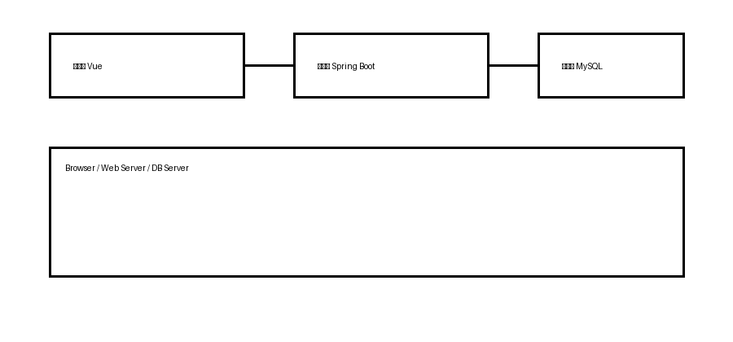

# 摘    要

近年来，计算机技术高速发展，已经渗透到各行各业中，药房也不例外。药品的高效管理在药房的整个管理中发挥着至关重要的作用。药品的管理水平直接反映着整个药房的管理水平。计算机技术的应用不仅让药房的管理水平有了质的飞跃，而且还降低了管理成本，能够创造出更高的价值。但在小型药房的药品管理中仍在使用人工管理的方式，不仅效率低下，还会造成大量的人力资源浪费。

基于以上问题，建立一套高效的药房信息管理系统是必然趋势。本文从需求分析、系统设计、系统实现与系统测试四个方面，介绍了如何利用计算机实现药品的有效管理。系统采用B/S架构，后端使用Spring Boot框架，前端使用Vue框架，数据库采用MySQL。测试结果表明，系统功能完整、响应及时，能够满足中小型药房的日常管理需求。

【关键词】药房管理；Spring Boot；B/S架构；MySQL；信息系统

# Abstract

In recent years, the rapid development of computer technology has penetrated into all walks of life, and pharmacies are no exception. Efficient management of medicines plays a vital role in the overall management of a pharmacy. The application of computer technology not only makes a qualitative leap in the management level of pharmacies, but also reduces management costs and creates higher value.

To solve the above problems, building an efficient pharmacy information management system is an inevitable trend. This paper introduces how to use computers to realize effective drug management from four aspects: requirement analysis, system design, system implementation and system testing. The system adopts the B/S architecture, with Spring Boot as the back-end framework, Vue as the front-end framework, and MySQL as the database. Test results show that the system is fully functional and responsive, and can meet the daily management needs of small and medium-sized pharmacies.

【Keywords】Pharmacy Management  Spring Boot  B/S Architecture  MySQL  Information System

# 第1章 引言

## 1.1 研究背景与意义

药品的高效管理在药房的整个管理中发挥着至关重要的作用。传统的人工管理方式效率低下，且容易造成药品出入库顺序混乱、有效期管理失效等问题，因此开发一套面向中小型药房的药品管理系统具有现实意义。

## 1.2 国内外研究现状

国外药房信息化起步较早，已形成较为完整的药品供应链管理体系。国内近年来也涌现出大量药房管理系统，但多数系统面向大型连锁药房，功能冗余、部署成本高，不适合中小型药房使用。

## 1.3 论文主要研究内容

本文的主要工作包括三个方面：

- 分析中小型药房的业务流程，梳理功能性与非功能性需求；
- 完成系统总体架构、功能模块与数据库设计；
- 实现系统并进行功能测试与性能测试。

# 第2章 关键技术

## 2.1 Spring Boot框架

Spring Boot是在Spring框架基础上发展而来的快速开发框架，其核心特性是自动配置与起步依赖，能够显著降低企业级应用的搭建成本。系统整体架构如图2-1所示。



## 2.2 MySQL数据库

MySQL是一款开源的关系型数据库管理系统，具有体积小、速度快、成本低等优点，适合中小型信息系统的数据存储需求。

# 第3章 系统设计与实现

## 3.1 功能模块设计

系统共划分为药品管理、库存管理、销售管理、用户管理四个功能模块，各模块的主要职责如表3-1所示。

表3-1 系统功能模块划分

| 模块名称 | 主要功能 | 使用角色 |
| --- | --- | --- |
| 药品管理 | 药品信息的增删改查、分类维护 | 管理员 |
| 库存管理 | 入库、出库、库存预警 | 管理员、库管员 |
| 销售管理 | 销售开单、退货处理、销售统计 | 收银员 |
| 用户管理 | 账号管理、角色与权限分配 | 管理员 |

## 3.2 库存预警算法

系统采用基于安全库存的预警策略，当某药品的当前库存量低于其安全库存阈值时触发预警。预警判定条件如式（3-1）所示。

```formula (3-1)
Q_current < Q_safe
```

式中，$$Q_{current}$$为药品当前库存量，$$Q_{safe}$$为该药品的安全库存阈值。

# 总    结

本文围绕中小型药房的实际管理需求，设计并实现了一套基于Spring Boot的药房管理系统。系统实现了药品管理、库存管理、销售管理与用户管理等核心功能，测试结果表明系统运行稳定、响应及时。

受时间与条件限制，系统尚未接入医保结算接口，后续可在此基础上进一步扩展移动端功能。

# 致    谢

本论文的工作是在张三老师的悉心指导下完成的，张三老师严谨的治学态度和科学的工作方法给了我极大的帮助和影响。在此衷心感谢张三老师对我的关心和指导。

# 参考文献

[1] 吴功宜.计算机网络(第三版)[M].北京:清华大学出版社,2011:5-26.

[2] 符萌,郭进,王小敏等.铁路信号设备可靠性研究[J].中国铁路,2009,(12):56-59.

[3] 王玺.基于安全信息传输网的分布式计算机联锁系统设计[D].北京:北京交通大学,2006:50-54.

# 附    录

### 附录A 核心代码

```java
@RestController
@RequestMapping("/api/drug")
public class DrugController {
    @Autowired
    private DrugService drugService;
}
```
